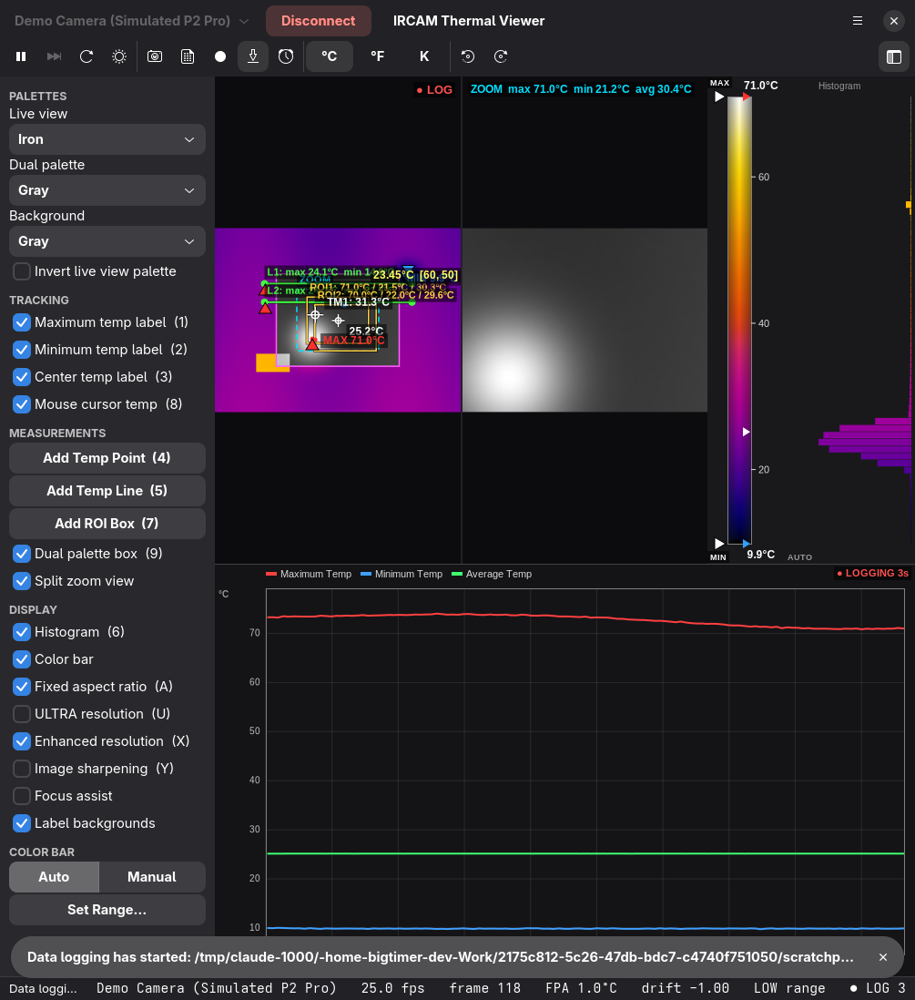

# IRCAM Thermal Viewer for Linux

A native Linux port of [OpenRMH-IRCAM](https://github.com/Cyclotronic/OpenRMH-IRCAM), the IRCAM
Thermal Viewer for USB thermal cameras. The original is a Windows (WinForms/OpenGL/DirectShow) app.
This port rewrites it in Python with GTK4/libadwaita. It reads V4L2 directly and talks to USB
through libusb. No Wine is needed.



## Install

```sh
git clone https://github.com/bigtimer-dev/ircam-linux && cd ircam-linux && ./install.sh
```

Or run it from the checkout without installing: `python3 -m ircam` (`--demo` adds a simulated camera).

**Requirements**
- Python 3 with PyGObject and pycairo
- GTK ≥ 4.12 and libadwaita ≥ 1.6
- numpy

**Optional**
- `ffmpeg`: processed video is saved as MP4. Without it you get an uncompressed AVI.
- `libusb-1.0`: needed for P2 Pro range switching and for the Thermal Master P3.

Your user must be in the `video` group. The installer offers a udev rule
(`data/99-ircam-linux.rules`) that gives that group raw USB access to the P2 Pro and P3.

## Supported cameras

These are the same models as the Windows app, grouped by protocol "pool":

| Pool | Cameras | Linux transport |
|---|---|---|
| 1 | InfiRay T2L, T2-Search, T2S+, T2Pro/T2SPro, T3-Search, T3S, T3Pro, DV-DL13, S0 series, HTI HT-301 | V4L2 + UVC zoom register commands |
| 2 | InfiRay P2 / P2 Pro / Tiny1-C, TOPDON TC001/TS001/TC002/TC003, UNI-T UTi260M, Victor 328B, LODESTAR L2 | V4L2 (256×384 YUYV) |
| 3 | InfiRay V2 models (T2L V2, T2-Search V2, T2S+ V2, T2Pro V2) | V4L2 + NUC from closed-shutter frame |
| 4 | Thermal Master P2 | V4L2 (256×386) |
| 5 | Thermal Master P3 | libusb (vendor protocol, bulk stream) |
| 6 | Thermal Master THOR001 | V4L2 (raw frames labelled H264) |

The camera is found automatically by its V4L2 name or USB id. You can also choose a specific
`/dev/video*` device under Settings → Camera.

## Feature map (Windows → Linux)

| Windows feature | Linux |
|---|---|
| Live view with max/min/center/cursor tracking labels | ✓ |
| 10 temperature points, 5 lines, 10 ROIs (move, resize, delete) | ✓ |
| Dual palette box, background palette, inverted palettes | ✓ |
| Split zoom view | ✓ |
| Rotation (button, R, or mouse wheel) | ✓ (objects follow the rotation) |
| 52 built-in palettes + Palette Creator | ✓ (custom palettes in `~/.config/ircam-linux/palettes`) |
| Color bar: auto/manual, draggable arrows, wheel adjust, ticks, center arrow | ✓ |
| Histogram (frame / zoom / ROI n / line n) | ✓ |
| ULTRA resolution, enhanced resolution, sharpening, focus assist | ✓ |
| °C / °F / K | ✓ |
| 2D plot (10 data sets, ticks, grid, cursor label) | ✓ |
| CSV data logging (`DataLogSession_*.txt`) | ✓ same format |
| Full-frame temperature data (`FrameTempData_*.txt`) | ✓ same format |
| Snapshots (`Snapshot_*.png` + `SnapShotRAW_*.png`) | ✓ RAW PNG is byte-compatible with the Windows app |
| Video recording + RAW recording | ✓ MP4 via ffmpeg + `RAWRecording_*.avi` (uncompressed, reopenable) |
| Snapshot / Recording Analysis modes, playback controls | ✓ (also `ircam-linux file.png/.avi`) |
| 5 temperature alarms with sound and trigger actions | ✓ |
| 5 periodic triggers | ✓ |
| Calibration: manual, periodic, on drift | ✓ (cameras that support it) |
| High/low temperature range | ✓ pools 1/3/5, **plus P2 Pro** (new on Linux) |
| Automatic range switching | **new**: goes to the high range when the hottest point reaches a set limit (default 140 °C) and back at a lower limit (120 °C); the active range is read from the P2 Pro on connect |
| Camera temperature configuration (emissivity, ambient, …) | ✓ |
| Emissivity table (double-click applies) | ✓ |
| 3D surface plot (fill/points/lines, rotate, pan, zoom, snapshot) | ✓ cairo renderer |
| Statistics window | ✓ |
| Hotkeys 1–9, A, C, F, H, K, M, N, O, P, Q, R, S, T, U, V, X, Y | ✓ (see menu → Keyboard Shortcuts) |
| Screen-capture tool during recording | ✓ any command, `%f` = output file (e.g. `wf-recorder -f %f`) |

### Differences from the Windows app

- **P2 Pro range switching** is new. It uses the camera's vendor mailbox, which is not used by
  the Windows app.
- **P2 Pro / pool 2 shutter calibration** is still not supported, the same as in the Windows app.
  The camera runs its own automatic shutter.
- **Emissivity on pool 2/4/5/6 cameras** uses the original's linear model unchanged. In that
  model the emissivity cancels out of the gain and only enters the reflected-temperature offset.
  As a result, lowering the emissivity lowers the reading. This matches the Windows app.
- The Windows build had RAW video recording only partly implemented. Here, RAW recordings are
  AVI files that use the same frame layout as RAW snapshots, with the same ID row.

## Development

```sh
python3 -m unittest discover -s tests   # core tests, no camera or display needed
python3 -m ircam --demo                 # simulated P2 Pro
python3 tools/extract_resources.py SRC  # regenerate palettes/emissivity from the original sources
```

`ircam/` contains:
- `cameras` (models), `thermal` (temperature maths) and `imageproc` (AGC, palettes, sharpening)
- `v4l2`, `usb`, `p2pro` and `p3` (camera I/O)
- `rawfiles` (RAW PNG and AVI)
- `sources` and `engine` (acquisition and the processing pipeline)
- `ui/` (the GTK interface)

## Credits

- [OpenRMH-IRCAM](https://github.com/Cyclotronic/OpenRMH-IRCAM) is the original application.
- The P2 Pro vendor control protocol (range switching) follows [p2pro-rs](https://github.com/mbuesch/p2pro-rs) by Michael Büsch.

## License

MIT, the same as the original. See [LICENSE](LICENSE). This keeps the original copyright of Rune
Mark Hansen and Cyclotronic. The palettes and the emissivity table are extracted from the
original's resource files. For authorship notes, see the original project's
[NOTICE.md](https://github.com/Cyclotronic/OpenRMH-IRCAM/blob/main/NOTICE.md).
